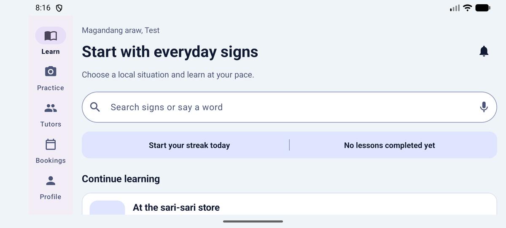
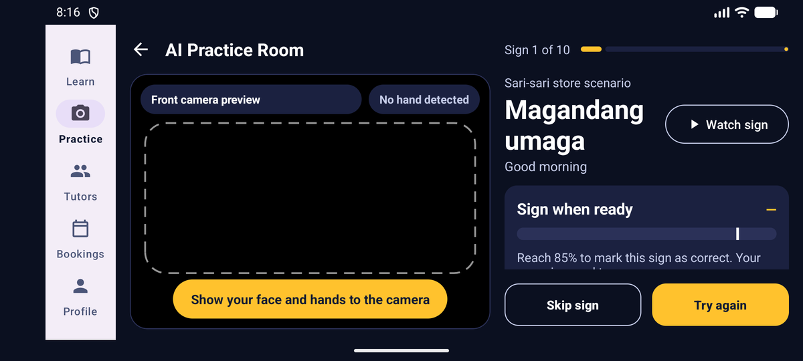
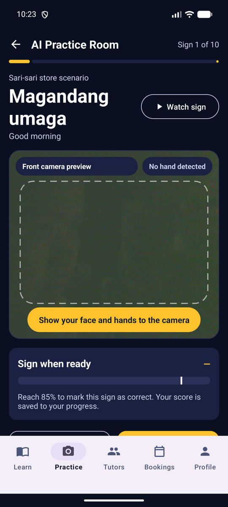
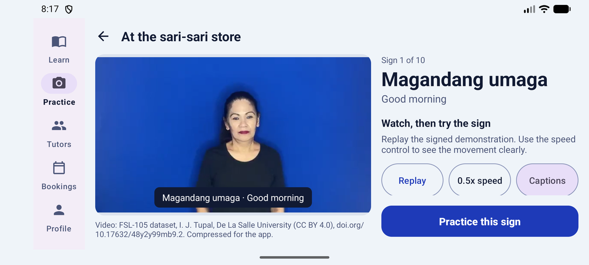
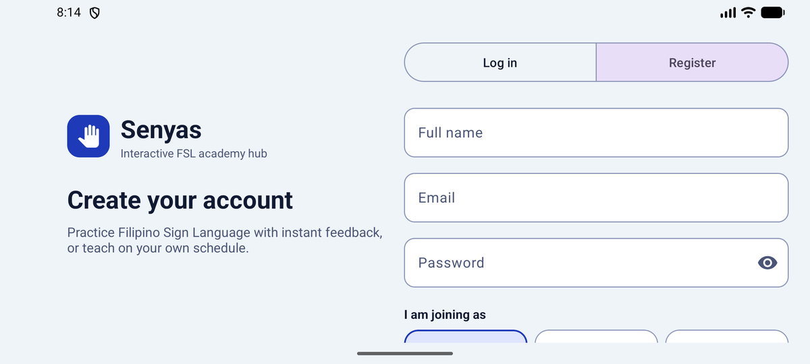

# Senyas: Learning Filipino Sign Language with Camera Feedback

Senyas is an Android app for learning Filipino Sign Language (FSL) with real-time feedback from the phone's camera.
It also connects learners with Deaf tutors for booked lessons.
It was built by Group benTEN as a Mobile Computing class project; the full proposal is in [docs/proposal](docs/proposal/).

## Contents

1. [Abstract](#1-abstract)
2. [Features](#2-features)
3. [Screenshots](#3-screenshots)
4. [System design](#4-system-design)
5. [Sign scoring method](#5-sign-scoring-method)
6. [Evaluation](#6-evaluation)
7. [Repository structure](#7-repository-structure)
8. [Getting started](#8-getting-started)
9. [Testing](#9-testing)
10. [Data, models and credits](#10-data-models-and-credits)
11. [Limitations](#11-limitations)
12. [License](#12-license)

## 1. Abstract

Many hearing Filipinos want to learn FSL, but practice without a teacher gives no feedback.
Senyas tracks both hands with MediaPipe and compares the learner's whole movement with built-in references from the FSL-105 dataset.
It scores each attempt from 0 to 100 and names the part to fix: hand shape, palm direction, movement or the second hand.
Against signers it has never seen, it accepts 87% of correct signs and wrongly accepts only 1.4% of other signs.

## 2. Features

- **Practice scenarios.** Three everyday situations (sari-sari store, jeepney, public services) teach 20 signs in context.
- **Built-in videos.** Every practice sign has an FSL-105 demonstration video inside the APK, so nothing has to be downloaded.
- **AI Practice Room.** The front camera scores the whole sign, start to finish; a held pose never passes.
- **Corrections in plain words.** Tips such as "At the start: straighten your index finger" appear in English and Filipino.
- **Hands of one signer only.** A face check rejects feet and stray objects, and the room says when there are too many hands or people.
- **Accounts on the device.** Each account keeps its own scores, streak and bookings; a new account starts empty.
- **Sign dictionary.** Typed or spoken search finds 26 signs, each with its video.
- **Tutor marketplace.** Learners book Deaf tutors, tutors publish lessons, and an admin console reviews listings and payouts.
- **Sign Lab.** Educators can record signs and test recognition for words that have no built-in reference yet.
- **Portrait and landscape.** Every screen adapts to both orientations, with a navigation rail in landscape.

## 3. Screenshots

| New account, Learn (landscape) | AI Practice Room (landscape) | AI Practice Room (portrait) |
| --- | --- | --- |
|  |  |  |

| Sign lesson with video | Register |
| --- | --- |
|  |  |

## 4. System design

The practice pipeline runs fully on the phone; no frame leaves the device.

| Stage | Component | Role |
| --- | --- | --- |
| 1 | CameraX (`HandTracker`) | Gives 640x480 frames, turned upright for the current screen rotation. |
| 2 | MediaPipe Hand Landmarker | Finds up to four hands with 21 3D points each. |
| 3 | MediaPipe Face Detector | Finds faces in the same frame, so only a person's hands count. |
| 4 | `HandGate` | Keeps at most two hands of one signer inside the signing space around the face. |
| 5 | `SignScorer` | Aligns the movement with the built-in references and scores six parameters. |
| 6 | `PracticeFragment` | Shows the score, the most useful tip and the finger colours on the overlay. |

App code lives in three Java packages:

- `com.benten.senyas`: screens, accounts (`AccountStore`, `Progress`) and sample marketplace data (`Repo`).
- `com.senyas.cv`: camera, hand and face tracking, the hand gate, Sign Lab recording and recognition.
- `com.senyas.ml`: the sign scorer, its references and its tips.

## 5. Sign scoring method

A sign is judged on the parameters FSL teachers use; each gets its own 0-100 sub-score.

- **Handshape:** finger joints measured in the hand's own palm frame, so hand size and rotation do not matter.
- **Orientation:** where the fingers point and where the palm faces.
- **Movement and size:** the dominant hand's path, centred on itself, and how large it is.
- **Direction:** whether the hand moves the same way as the references at each moment, so a reversed sign fails.
- **Two hands:** whether the second hand is present and placed as in the references, or still for one-handed signs.

The live stream is aligned with each whole reference by open-begin, open-end dynamic time warping, allowing 3x slower to 2x faster signing.
Each tolerance is learned from how much the four FSL-105 signers differ, and the weakest sub-score becomes the score.
Each sign's pass threshold is set just below its closest look-alike among the built-in signs.
The full method, pipeline and data are documented in [ml/references](ml/references/README.md).

## 6. Evaluation

The scorer was tested leave-one-signer-out: references come from three FSL-105 signers and the fourth plays the learner.

| Probe | Meaning | Passes |
| --- | --- | --- |
| P | The right sign by an unseen signer | 87.1% |
| E | The same at half the frame rate | 86.9% |
| N | Any other of the 105 FSL-105 signs | 1.4% |
| H | One moment of the sign held still | 0.0% |
| R | The sign played backwards | 42.9% |

Backwards passes come mostly from tapping and nodding signs, which look the same reversed.
Per-sign results and the threshold study are in [ml/references/results](ml/references/results/).

## 7. Repository structure

| Path | Contents |
| --- | --- |
| [`android/`](android/) | The Android Studio project (Java 11, API 26+). |
| [`android/app/src/main/assets`](android/app/src/main/assets) | MediaPipe models, 26 sign videos and 26 sign reference files. |
| [`ml/references/`](ml/references/) | Python pipeline that builds the references, videos and thresholds, and evaluates the scorer. |
| [`ml/classifier/`](ml/classifier/) | Python pipeline that trains an optional TensorFlow Lite sign classifier for Sign Lab. |
| [`docs/proposal/`](docs/proposal/) | The project proposal. |
| [`docs/screenshots/`](docs/screenshots/) | App screenshots. |

## 8. Getting started

Requirements: Android Studio (or its bundled JDK) and the Android SDK with API 37.
The app runs on Android 8.0 (API 26) or newer, and a real phone is best for the camera.

1. Open the `android` folder in Android Studio and press **Run**, or build from a terminal:

   ```bash
   cd android
   ./gradlew assembleDebug
   ```

2. Install `android/app/build/outputs/apk/debug/app-debug.apk` on the phone.
3. Register an account, open **Practice**, watch a sign, then tap **Try again** and sign it with your face and hands in view.

Release signing reads `android/keystore.properties`, which is not in the repository; without it the release build is unsigned.
See [android/README.md](android/README.md) for signing and command-line details.

## 9. Testing

The Android unit tests cover accounts, progress, the hand gate and the scorer (75 tests).

```bash
cd android
./gradlew testDebugUnitTest
```

`SignScorerParityTest` checks that the Java scorer gives the same scores and tips as the Python design on all 26 signs.
The Python pipelines have their own checks; see each folder's README.

## 10. Data, models and credits

- **FSL-105** by I. J. Tupal, De La Salle University, CC BY 4.0, [doi.org/10.17632/48y2y99mb9.2](https://doi.org/10.17632/48y2y99mb9.2). The sign videos and references are derived from it.
- **MediaPipe** Hand Landmarker and BlazeFace short-range face detector by Google, Apache License 2.0.
- No learner video or image leaves the phone; accounts and progress are stored on the device.

## 11. Limitations

- Only the 26 signs from FSL-105 are scored; other signs need recordings in Sign Lab.
- FSL-105 is filmed from a distance, while learners hold the phone close, so real-world accuracy may be lower than the table above.
- The scorer uses hands only; facial expressions, which are part of FSL, are not graded.
- Accounts live on one phone; cloud sign-in (Firebase) is planned but not built.

## 12. License

The code is released under the [MIT License](LICENSE).
The FSL-105 videos and derived references remain under CC BY 4.0 and require the credit above.
