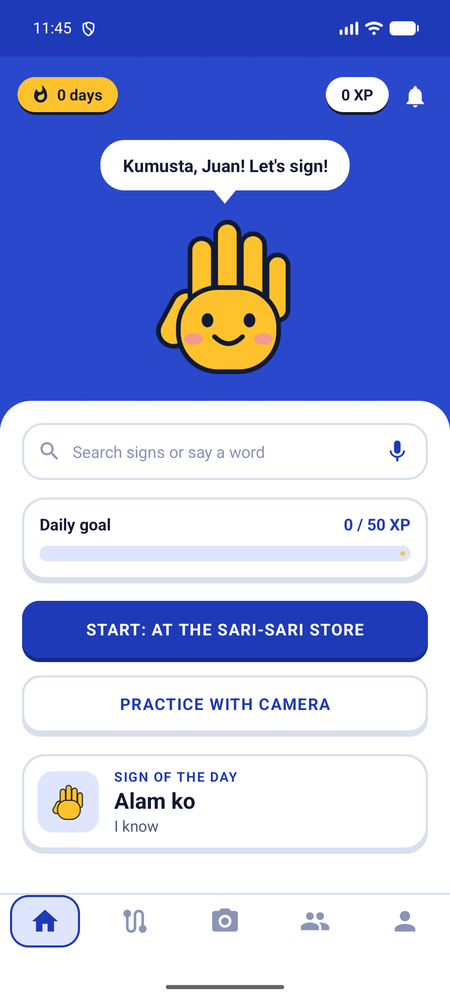
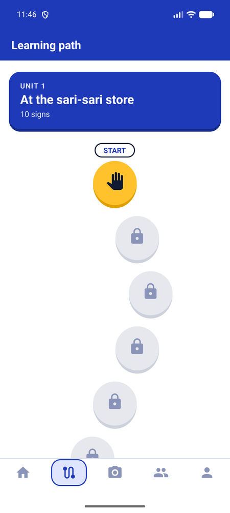
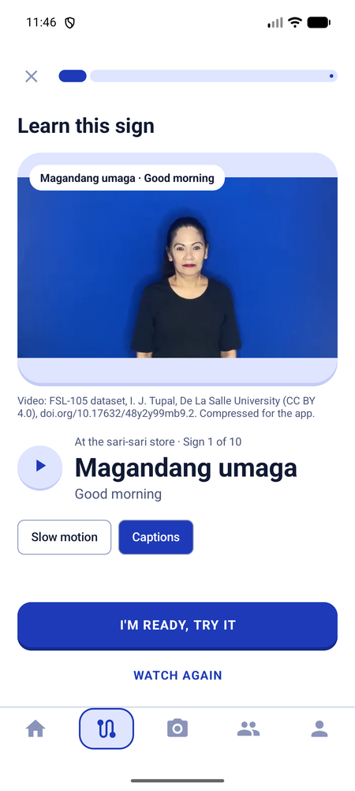
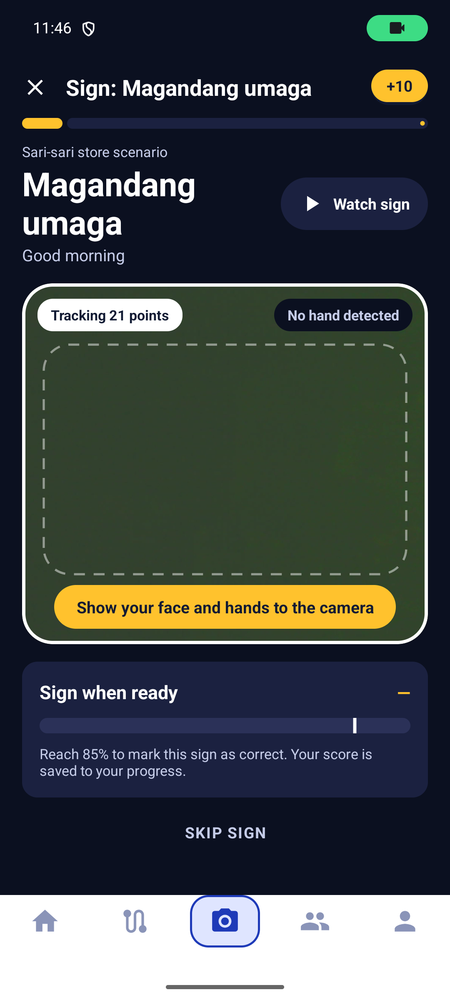

<div align="center">

# Senyas

**Learn Filipino Sign Language on your phone, with a camera that checks your signing.**


</div>

Many hearing Filipinos want to learn Filipino Sign Language (FSL) so they can talk with Deaf family members, friends and customers. Practising alone is hard, because nobody tells you whether your hands are doing the right thing.

Senyas shows a short video of a real signer, then watches you copy the sign through the front camera and fills a match bar as you go. When you have learned the basics, you can book a one-on-one lesson with a Deaf tutor inside the same app.

Senyas was built by **Group benTEN** as a Mobile Computing class project. The original proposal is in [`docs/proposal`](docs/proposal/).

| Home | Learning path | Watch the sign | Practise with the camera |
| :---: | :---: | :---: | :---: |
|  |  |  |  |

## What you can do

**Learners** (Hearing Learner or Deaf Student accounts)

- Follow a learning path through three everyday situations: buying at a sari-sari store, riding a jeepney, and asking for help at public services.
- Watch each sign performed by a real signer, with slow motion and captions.
- Sign in front of the camera. Reaching **85** on the match bar marks the sign as correct and earns XP.
- Keep a daily streak and an XP goal, and search for signs by typing or speaking.
- Book a Deaf tutor at a time the tutor has published, then join the class when it starts.

**Deaf tutors** publish lessons with a price, a length of 30 or 60 minutes, and the dates and times they are free. They see their upcoming sessions, can test their camera before class, and track their earnings.

**Administrators** approve each tutor lesson before learners can see it, manage user accounts, and release tutor payouts after a session has ended.

The app is available in English and Filipino, in light and dark themes.

## How the camera checks your signing

1. **The camera watches.** Frames from the front camera are processed on the phone. Nothing is recorded or uploaded.
2. **Dots are placed on your body.** Google's MediaPipe finds 21 points on each hand, plus your shoulders, elbows, wrists and nose.
3. **A trained model names the sign.** A small neural network, trained on 2,130 video clips of 105 FSL signs, looks at your last few seconds of movement and decides which of the 105 signs it most looks like.
4. **The match bar decides.** The bar only passes 85 when the model is confident you made the sign the lesson asked for, and clearly not a look-alike. A still pose, random waving or an empty frame never passes.

When you finish a sign, lower your hands for a moment. That tells the app your attempt is over. The full explanation is in [How sign checking works](docs/sign-recognition.md).

## Signs the camera can grade

All signs and videos come from the FSL-105 dataset (credits below).

| Filipino | English | Video | Graded by camera |
| --- | --- | :---: | :---: |
| Magandang umaga | Good morning | ✅ | ✅ |
| Kumusta | Hello | ✅ | ✅ |
| Salamat | Thank you | ✅ | ✅ |
| Walang anuman | You're welcome | ✅ | ✅ |
| Oo | Yes | ✅ | ✅ |
| Hindi | No | ✅ | ✅ |
| Tatay | Father | ✅ | ✅ |
| Magandang gabi | Good evening | ✅ | ❌ failed the accuracy test |
| Nanay | Mother | ✅ | ❌ failed the accuracy test |

Lesson words outside this list, such as *Bili* (buy) or *Para* (stop here), say that no verified video is available yet. You can skip them; skipping never awards XP.

## How accurate it is

The model was tested on the 426 official FSL-105 test clips, which it never saw during training.

| Check | Result |
| --- | --- |
| Names the right sign out of all 105 | 85% of clips |
| Accepts a correct performance of one of the 7 graded signs | 24 of 28 (86%) |
| Wrongly accepts a different sign as one of the 7 | 0 |
| Accepts a still pose, a fist, an open palm or no hands | 0 of 308 |

These numbers come from a small test set, so read them as a progress check rather than a final score:

- There are only about four test clips per sign.
- The dataset does not say which person signed which clip, so we cannot yet show how well it works for someone new.
- The rule for "attempt finished" was tuned after looking at early test results.
- FSL-105 was filmed from a distance in a studio. Learners usually hold a phone close, in ordinary light.

## Two ways to run the app

| Version | Where accounts and bookings live | Best for |
| --- | --- | --- |
| **Offline** (`debug`, `release`) | Only on that phone | Trying the app with no setup |
| **Connected** (`connected`) | A shared Firebase project | Real tutors and learners on different phones |

Learning progress works offline in both. See [Accounts, lessons and bookings](docs/accounts-and-bookings.md) for how roles, approvals and double-booking protection work.

## What's in this repository

| Folder | What it is |
| --- | --- |
| [`android/`](android/) | The Android app, written in Java. Open this folder in Android Studio. |
| [`backend/`](backend/) | Firebase security rules that protect accounts, lessons and bookings, with their tests. |
| [`ml/`](ml/) | Python scripts that train the sign model from the FSL-105 videos. |
| [`docs/`](docs/) | How the app works, the project proposal and screenshots. |
| [`CHANGELOG.md`](CHANGELOG.md) | What changed in each version. |

## Build and run

You need [Android Studio](https://developer.android.com/studio) with the Android SDK for API 37. The app runs on Android 8.0 or newer; a real phone works better than an emulator for the camera.

```bash
git clone https://github.com/rhain-r/senyas.git
cd senyas/android
./gradlew assembleDebug
```

Install `android/app/build/outputs/apk/debug/app-debug.apk` on your phone, or open the `android` folder in Android Studio and press **Run**. Register a new account, open **Practice**, watch a sign, then sign it with your face and hands in view.

The [Android guide](android/README.md) covers the other build types, the tests and the code layout.

## Known limitations

- Only 7 signs are graded so far; facial expressions, which are part of FSL grammar, are not checked.
- The live classroom shows your own camera and a whiteboard. Two-way video, chat and a shared whiteboard between tutor and learner are not built yet.
- Booking asks for GCash, Maya or card, but no money is charged or paid out.
- Most testing was done on an Android emulator, with limited testing on physical phones.

## Credits

- **FSL-105** dataset by Isaiah Jassen Tupal, De La Salle University, [doi.org/10.17632/48y2y99mb9.2](https://doi.org/10.17632/48y2y99mb9.2), CC BY 4.0. The sign videos and the training data come from it.
- **MediaPipe** Hand Landmarker and Pose Landmarker by Google, Apache License 2.0.

## License

The code is released under the [MIT License](LICENSE). The FSL-105 videos and the model trained from them remain under CC BY 4.0 and require the credit above.
